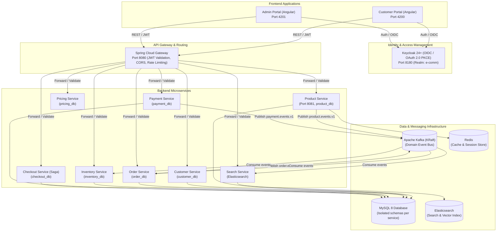
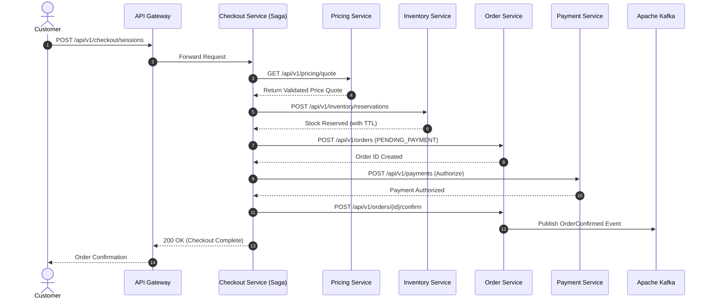

# e-comm Architectural Specification

This document details the engineering architecture for **e-comm**, an advanced enterprise-grade microservices e-commerce platform built on Java 21, Spring Boot 3, Angular, Keycloak, Kafka, MySQL 8, Redis, and Elasticsearch, fully orchestrated using Docker Compose.

---

## 1. High-Level System Architecture



---

## 2. Microservice Boundaries & Data Ownership

| Domain | Service | Responsibility | Dedicated Data Store |
|---|---|---|---|
| Identity | Keycloak | OIDC login, token issuance, user credentials, roles | `keycloak_db` |
| Customer | Customer Service | Customer profile, preferences, membership | `customer_db` |
| Customer | Address Service | Delivery & billing addresses, delivery zones | `address_db` |
| Catalog | Product Service | Products, SKUs, variants, specifications, publishing | `product_db` |
| Catalog | Category Service | Category tree, brands, dynamic attributes | `category_db` |
| Catalog | Media Service | Media metadata, upload workflow, image processing | `media_db` + Object Storage |
| Catalog | Pricing Service | Prices, coupons, discounts, promotions | `pricing_db` |
| Discovery | Search Service | Full-text, fuzzy, faceted and vector search | Elasticsearch index |
| Shopping | Cart Service | Cart lifecycle, cart items, guest-to-user merge | `cart_db` + Redis |
| Shopping | Wishlist Service | Wishlists and saved items | `wishlist_db` |
| Shopping | Inventory Service | Stock tracking, warehouses, movements & reservations | `inventory_db` |
| Commerce | Checkout Service | Checkout orchestration & Saga execution state | `checkout_db` |
| Commerce | Order Service | Order lifecycle, immutable snapshots, status history | `order_db` |
| Transactions | Payment Service | Payment attempts, webhooks, capture, refunds | `payment_db` |
| Fulfilment | Shipping Service | Shipment creation, carrier tracking, delivery status | `shipping_db` |
| Fulfilment | Returns Service | Return eligibility, approvals, return workflows | `returns_db` |
| Intelligence | Recommendation Service | Behavior signals & personalized recommendations | `recommendation_db` + Vector index |
| Intelligence | AI Assistant Service | RAG, product Q&A, comparison, tool calling | `ai_assistant_db` + Vector index |
| Engagement | Notification Service | Email, SMS, push notifications | `notification_db` |
| Engagement | Review Service | Ratings, reviews, moderation, helpful votes | `review_db` |

---

## 3. Kafka Event Topics & Specifications

All domain events adhere to the standard envelope schema:

```json
{
  "eventId": "uuid-v4",
  "eventType": "ProductPublished",
  "eventVersion": 1,
  "occurredAt": "2026-11-17T14:30:00Z",
  "producer": "product-service",
  "correlationId": "req-987654",
  "aggregateType": "Product",
  "aggregateId": "prod-001",
  "aggregateVersion": 1,
  "payload": {
    "productId": "prod-001",
    "name": "Pro Laptop 16\" M3",
    "price": 1999.99,
    "status": "PUBLISHED"
  }
}
```

Key Topics:
- `product.events.v1`: ProductCreated, ProductUpdated, ProductPublished
- `inventory.events.v1`: StockReserved, StockReleased, InventoryAdjusted
- `order.events.v1`: OrderCreated, OrderConfirmed, OrderCancelled
- `payment.events.v1`: PaymentAuthorized, PaymentCaptured, PaymentFailed
- `shipment.events.v1`: ShipmentCreated, ShipmentDispatched, ShipmentDelivered

---

## 4. Checkout Distributed Saga Workflow



---

## 5. Docker Compose Local Architecture

- Network: `ecomm-network` (bridge)
- Persistent Storage: `mysql_data`, `kafka_data`, `redis_data`, `elasticsearch_data`
- Port Mapping:
  - Frontend Customer: `4200`
  - Frontend Admin: `4201`
  - API Gateway: `8080`
  - Keycloak: `8180`
  - MySQL: `3306`
  - Kafka: `9092`
  - Redis: `6379`
  - Elasticsearch: `9200`
